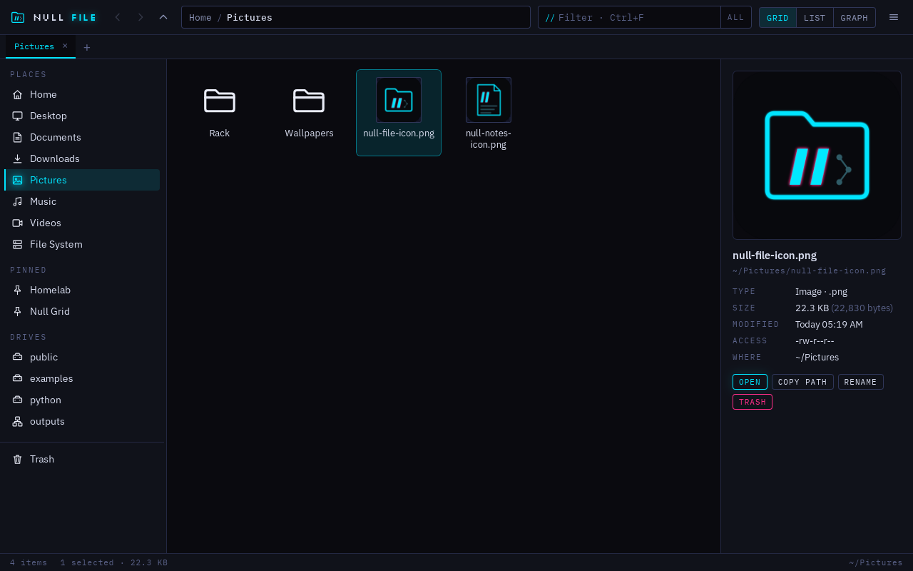
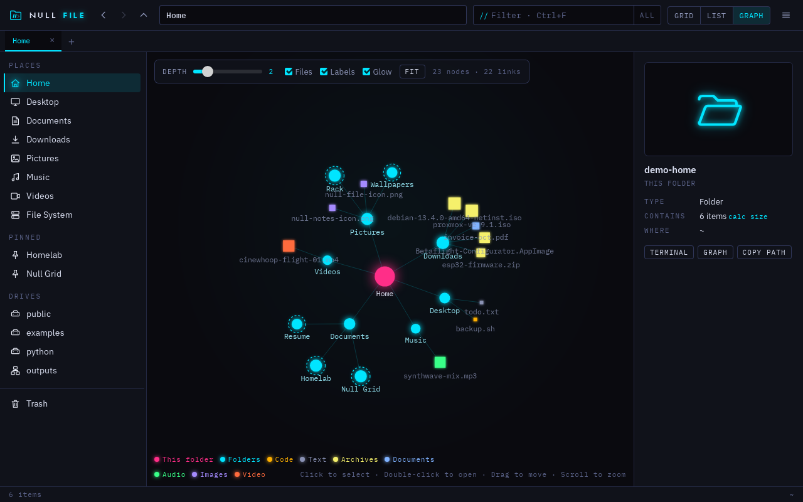
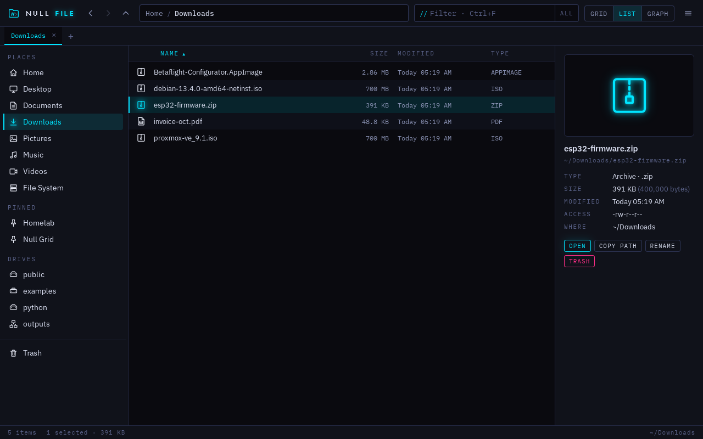
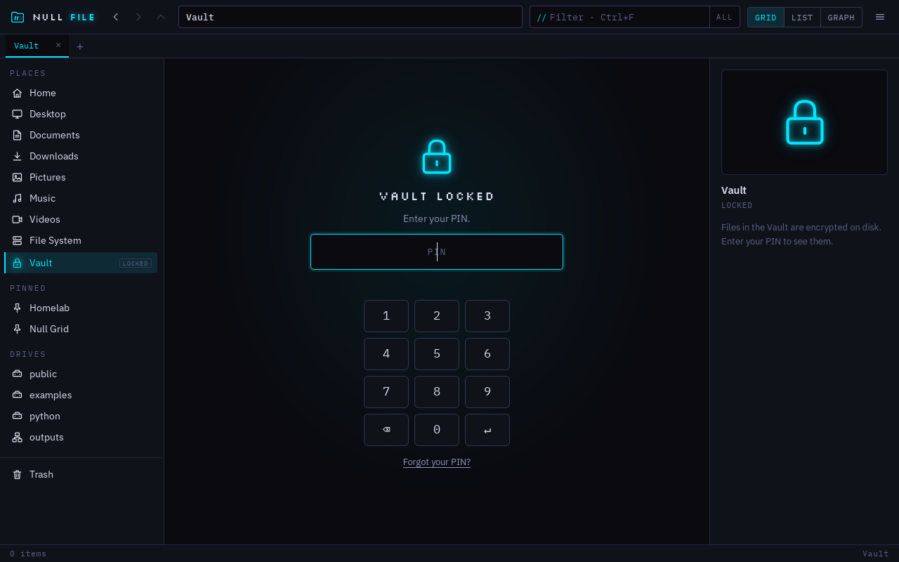
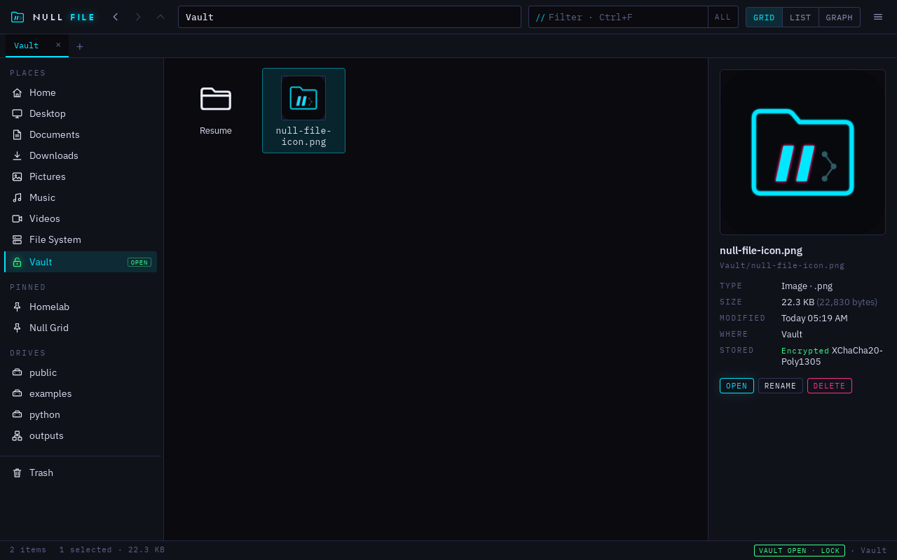

# Null File

**A fast file manager for Linux, with tabs, undo and a graph of your folders.**

Null File is a keyboard-friendly file manager in the Neon Lab look of **[Null Grid](https://nullgrid.dev)**, alongside Null Search, Null Notes and Null Drive. It's the default file manager in Null OS.



## Features

- **Tabs** (Ctrl+T, Ctrl+W, Ctrl+Tab, middle-click a folder) that reopen where you left off.
- **Breadcrumbs** you can click, drop onto, or type into (Ctrl+L, with `~` and `file://` paths).
- **Sidebar:** your places, pinned folders (drag a folder onto *Pinned*), mounted drives and network shares, and the Trash.
- **Grid and list views** with image thumbnails, sorting by name, size, date or type, and natural sort (`file2` before `file10`).
- **Details panel** (Ctrl+I) with previews of images, video, audio and text files, permissions, and folder sizes on demand.
- **Copy and move** with a live progress card and Cancel. Drag to move, hold Ctrl to copy. When names clash: Keep both, Replace or Skip.
- **Undo** (Ctrl+Z) for rename, move, copy, new folder and Move to Trash.
- **Find things fast:** type-ahead, filter as you type (Ctrl+F), press Enter to search every subfolder, and a **Ctrl+K command palette** for actions and folders (type `/` or `~` to jump by path, Tab to complete).
- **Graph view** (Ctrl+3): the folder tree as a force-directed map. Folders are circles, files are squares colored by type, sized by how much they hold. Depth slider, pan, zoom, drag, double-click to dive in.
- **Open a terminal here** (F4), Konsole first, then whatever terminal you have.
- **"Show in folder"** from your browser or any other app opens Null File with the file selected (when it's your default file manager).
- **Live updates** when files change on disk, and new drives appear in the sidebar on their own.
- **The Vault** (new in 1.1): a private folder in the sidebar that's encrypted on disk and opens with a PIN. See below.
- **Automatic updates** (new in 1.1): .deb and .rpm installs update with the rest of your system; the AppImage and tar.gz update themselves.

| Graph | List |
|---|---|
|  |  |

## Install

Download from [Releases](../../releases), for **x86_64** or **ARM64** (`aarch64`/`arm64` in the file name). Every package works on distros from 2022 on (glibc 2.35+, WebKitGTK 4.1).

| Distro | File | How |
|---|---|---|
| Ubuntu 22.04+, Debian 12+, Mint, Null OS | `null-file_1.2.0_amd64.deb` | `sudo apt install ./null-file_1.2.0_amd64.deb` |
| Fedora, openSUSE | `null-file-1.2.0-1.x86_64.rpm` | `sudo dnf install ./null-file-1.2.0-1.x86_64.rpm` (openSUSE: `sudo zypper install ./…`) |
| Arch, Manjaro, EndeavourOS | AUR: `null-file-bin` | `yay -S null-file-bin`, or build the attached `PKGBUILD` with `makepkg -si` |
| Any, without installing | `Null-File-1.2.0-x86_64.AppImage` | `chmod +x Null-File-*.AppImage`, then run it |
| Any, sandboxed; also RHEL, Rocky, Alma | `null-file-1.2.0-x86_64.flatpak` | `flatpak install ./null-file-1.2.0-x86_64.flatpak` |
| Any with snapd | `null-file_1.2.0_amd64.snap` | `sudo snap install --dangerous ./null-file_1.2.0_amd64.snap` (home folder and USB drives only) |
| Anything else | `null-file-1.2.0-linux-x86_64.tar.gz` | unpack, then `./null-file`, or `./install.sh` to add it to your app menu |

Check a download with `sha256sum -c SHA256SUMS --ignore-missing`.

### Updates

Installing the `.deb` or `.rpm` also adds the signed Null Grid package repository, so new versions arrive with your normal system updates (`sudo apt upgrade`, `dnf upgrade`, `zypper up`, KDE Discover, GNOME Software). The AppImage and the tar.gz check GitHub once a day and offer **Update now**, which downloads the new version, checks it against `SHA256SUMS` and restarts. Flatpak, Snap and AUR update through their own tools. Details: [docs/UPDATES.md](docs/UPDATES.md).

### Make it your default file manager

So "Open folder" in other apps and your desktop's file links open Null File:

```sh
null-file --set-default
```

or **☰ → Settings & shortcuts → Make Null File the default**. Both run `xdg-mime default <desktop file> inode/directory` for your user (on the host, for the Flatpak), which KDE Plasma, GNOME and most desktops follow. They also register Null File for "Show in folder" (`org.freedesktop.FileManager1`), so a browser's "Show in folder" after a download opens Null File with the file selected, even when Null File is closed. (Not in the Snap, which can't take that over.)

### Command line

```sh
null-file                     # open (reopens your last tabs)
null-file ~/Downloads /mnt    # a tab for each folder
null-file ~/notes/todo.md     # opens the folder with that file selected
null-file --set-default       # make it the default file manager
null-file --version
null-file --dbus              # what D-Bus runs for "Show in folder": stays hidden until asked
```

If Null File is already open, these open as new tabs in the existing window.

## The Vault

**Vault** in the sidebar is a folder only you can open. The first time, pick a PIN (3 to 300 digits) and write down the 24-word recovery key it shows you.

- **Unlocked**, it works like any folder: drag files in to encrypt them (moving deletes the unencrypted originals; hold Ctrl or use Copy to keep them), drag them out to decrypt, rename, preview, search, graph.
- **Opening a file in another app** gives that app a temporary decrypted copy in RAM-only storage (`$XDG_RUNTIME_DIR`). Edits you save there go back into the Vault when you return to Null File or lock it, and the copy is wiped on lock.
- **Locking:** the green **VAULT OPEN · LOCK** button in the status bar, Ctrl+Shift+L, after a few idle minutes (Settings → Vault), and always when Null File closes.
- **Deleting inside the Vault is permanent.** Vault files never go to the system Trash, where they'd sit unencrypted.
- **Wrong PINs:** after three, each try has to wait longer (5 seconds, doubling, up to 15 minutes).
- **Forgot the PIN?** "Forgot your PIN?" on the lock screen takes the 24 words and sets a new PIN. Without the PIN or the words, nobody can open the Vault, including us.

| Locked | Unlocked |
|---|---|
|  |  |

On disk it's `~/.local/share/dev.nullgrid.file/vault/`: random-named encrypted blobs and an encrypted index, so even file names and folder structure are hidden. How it's encrypted: [SECURITY.md](SECURITY.md).

A short PIN is quick to type but weak if someone copies the vault files off your disk: they can try every 4-digit PIN offline. Use 6 or more digits for anything important.

## Keyboard

| Keys | Does |
|---|---|
| Ctrl+K | Command palette |
| Ctrl+L | Type a path |
| Ctrl+F, then Enter | Filter this folder, then search every subfolder |
| Ctrl+T / Ctrl+W / Ctrl+Tab | New tab / close tab / next tab |
| Alt+← → ↑, Backspace | Back, forward, up, back |
| Ctrl+1 / 2 / 3 | Grid / list / graph |
| Enter, Ctrl+Enter | Open, open folder in a new tab |
| F2 | Rename |
| Delete | Move to Trash |
| Ctrl+C / X / V | Copy / cut / paste |
| Ctrl+Shift+C | Copy path |
| Ctrl+Z | Undo |
| Ctrl+Shift+N / Ctrl+Alt+N | New folder / new empty file |
| Ctrl+H | Show hidden files |
| Ctrl+I | Details panel |
| Ctrl+Shift+L | Lock the Vault |
| F4 | Terminal here |
| F5 | Refresh |

## Build from source

Needs Rust and the WebKitGTK 4.1 headers. There's no Node build step: the frontend is plain ES modules.

```sh
sudo apt install libwebkit2gtk-4.1-dev build-essential librsvg2-dev
cd src-tauri
cargo test              # backend tests
cargo run               # debug build
```

Packages: `packaging/linux/build-linux.sh` builds the AppImage, .rpm, .tar.gz and .deb for the machine you're on (needs `cargo install tauri-cli --version "^2"`). The Flatpak, Snap and AUR builds are described at the top of their files in `packaging/`.

### Releases

Actions → **Release** → Run workflow → type the version (it must match `src-tauri/tauri.conf.json`). It builds and tests every Linux package for x86_64 and ARM64 (installed on Ubuntu, Debian, Fedora, openSUSE and Arch), attaches them to the GitHub release with the notes from [CHANGELOG.md](CHANGELOG.md), and publishes the signed package repository to GitHub Pages. One-time setup for that: [docs/UPDATES.md](docs/UPDATES.md).

## Project layout

```
src/                 the window: index.html, style.css, app.js, graph.js, icons.js, backend.js
src-tauri/src/       Rust: fsops.rs (files), search.rs (search + graph), vault.rs (the Vault), update.rs (updates),
                     sysint.rs (desktop), lib.rs (commands)
packaging/           deb, rpm/AppImage/tar.gz, Flatpak, Snap, AUR, icon, repo (signed APT/DNF repository)
.github/workflows/   CI, Linux packages, Release
```

---

NULLGRID. All rights reserved. · *Your data. Your grid.*
